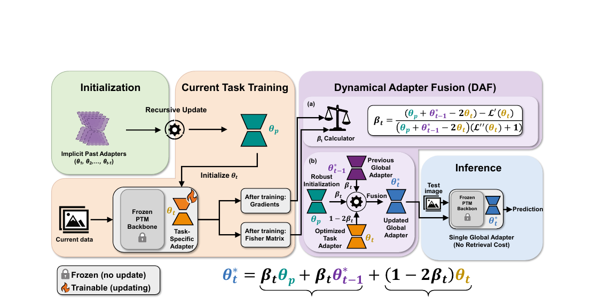
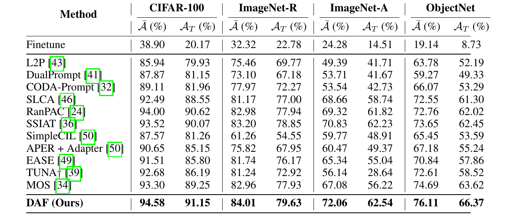
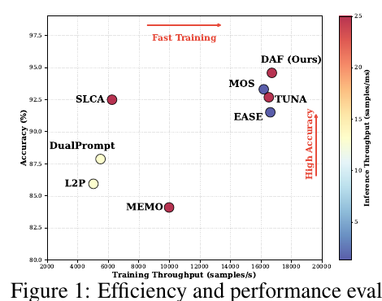

# Dynamical Adapter Fusion: Constructing A Global Adapter for Pre-Trained Model-based Class-Incremental Learning

[](https://arxiv.org/abs/2601.21341)

The official PyTorch repository for the paper "[Dynamical Adapter Fusion: Constructing A Global Adapter for Pre-Trained Model-based Class-Incremental Learning](https://arxiv.org/abs/2601.21341)".

### Overview

Dynamical Adapter Fusion (DAF) builds a single robust global adapter for Pre-Trained Model (PTM)-based Class-Incremental Learning (CIL). Guided by the PAC-Bayes theorem, DAF fuses three parameter states after each task: the optimized task-specific adapter, the previous global adapter, and the initialization parameters. The fusion coefficients are derived via a Taylor expansion of the loss and the method of Lagrange multipliers. A Robust Initialization strategy recursively averages historical adapters to capture global knowledge patterns. Inference uses only the global adapter, with no adapter retrieval.

<div align="center">

</div>

DAF achieves state-of-the-art accuracy on four CIL benchmarks while keeping high training and inference throughput:

<div align="center">

</div>
<div align="center">

</div>

## Setup

+ Install the dependencies:

    `pip install torch==2.0.1 torchvision==0.15.2 timm==0.6.12 easydict tqdm scipy`

+ The ViT-B/16-IN21K backbone weights are downloaded automatically by `timm`.
+ Set `DATA_ROOT` to the directory containing your datasets (default: `./data`):

    `export DATA_ROOT=/path/to/your/data`

+ Expected directory structure:

```
$DATA_ROOT/
├── cifar-100-python/       # CIFAR-100, auto-downloaded by torchvision
├── imagenet-r/
│   ├── train/
│   └── test/
├── imagenet-a/
│   ├── train/
│   └── test/
└── objectnet/
    ├── train/
    └── test/
```

### 🚀Quick Start
- Use `main.py` with a config file in `./exps/` to run experiments.
- To reproduce the results in the paper, run

    `python main.py --config ./exps/daf_<dataset>.json`
- For example, for CIFAR-100 (20 tasks), run \
    `CUDA_VISIBLE_DEVICES=0 python main.py --config ./exps/daf_cifar.json`
- Available configs: `daf_cifar.json` (CIFAR-100, 20 tasks), `daf_imagenetr.json` (ImageNet-R, 10 tasks), `daf_imageneta.json` (ImageNet-A, 10 tasks), `daf_objectnet.json` (ObjectNet, 10 tasks).
- To run all four benchmarks sequentially, run `bash run.sh`.

## Acknowledgements
We extended the [PILOT](https://github.com/sun-hailong/LAMDA-PILOT) codebase with our method.
We extend our gratitude to the authors for their support and for providing the research community with the PILOT toolbox.

## Citing this work
If you find the project helpful, please consider citing our paper:
```bibtex
@article{liu2026dynamical,
  title={Dynamical Adapter Fusion: Constructing A Global Adapter for Pre-Trained Model-based Class-Incremental Learning},
  author={Liu, Ruiqi and Diao, Boyu and An, Zijia and Shao, Runjie and Ge, Feixiang and An, Zhulin and Wang, Fei and Xu, Yongjun},
  journal={arXiv preprint arXiv:2601.21341},
  year={2026}
}
```
